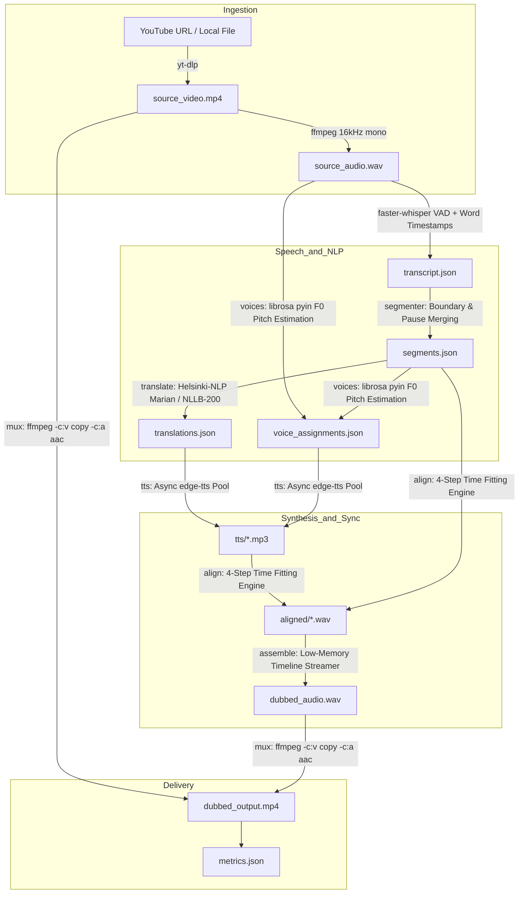

# Dubber: Production-Quality AI Video Dubbing CLI

**Dubber** is a high-performance Python CLI tool that automatically dubs YouTube videos (from Hindi, French, German, and other languages) into natural-sounding English speech while maintaining synchronization with the original speaker's timing and preserving video stream bit-identity without re-encoding.

---

## 1. Architecture Overview



### ASCII Pipeline Flow
```
[YouTube URL] 
     │
     ▼ (1. Download: yt-dlp)
[source_video.mp4] 
     │
     ▼ (2. Audio Extraction: FFmpeg 16kHz mono)
[source_audio.wav] 
     │
     ▼ (3. ASR: faster-whisper large-v3 / small with VAD & Word Timings)
[transcript.json] 
     │
     ▼ (4. Sentence Segmenter: Punctuation & Silence Pause Splitting)
[segments.json] ────────┐
     │                  ▼ (6. Voice Assignment: librosa pyin F0 Pitch)
     ▼ (5. Translation) [voice_assignments.json]
[translations.json]     │
     │                  │
     └────────┬─────────┘
              ▼ (7. TTS: Async Microsoft Neural edge-tts)
         [tts/*.mp3]
              │
              ▼ (8. Time Alignment: 4-Step Fitting & Gap Borrowing)
       [aligned/*.wav]
              │
              ▼ (9. Timeline Assembly: Sample-Accurate Streaming)
      [dubbed_audio.wav]
              │
              ▼ (10. Lossless Multiplexing: ffmpeg -c:v copy -c:a aac)
      [dubbed_output.mp4] + [metrics.json]
```

---

## 2. Setup & Installation (Windows & CUDA)

### Prerequisites
- **Python 3.10+** (Recommended: Python 3.11)
- **FFmpeg**: Must be on your system `PATH` (or installed via `winget install Gyan.FFmpeg`). Dubber also includes automatic fallback detection via `imageio-ffmpeg`.
- **GPU (Optional but Recommended)**: NVIDIA RTX (e.g., RTX 4050 6GB) with CUDA 12.x drivers.

### Quickstart Setup
```powershell
# 1. Clone or navigate to the repository
git clone https://github.com/AyushGupta011/AI-Dubber

# 2. Create virtual environment
python -m venv .venv
.\.venv\Scripts\Activate.ps1

# 3. Install dependencies
pip install -r requirements.txt
```

### Windows CUDA & cuDNN Note
`faster-whisper` and PyTorch use pre-built wheels with CUDA support. If CUDA is present, Dubber automatically runs inference on `cuda` with `compute_type="int8_float16"`, adhering to the laptop VRAM ceiling. If CUDA is not detected or VRAM is constrained, it seamlessly falls back along the fallback chain to CPU int8 execution.

---

## 3. Voice Matching & Audio Quality Enhancements

Dubber features multi-tier voice matching so the dubbed English audio sounds natural and closely matches the original speaker's vocal characteristics:

1. **Multi-Tier Voice Palette**: Automatically classifies speaker voice profiles based on fundamental frequency ($F_0$):
   - **Deep Male** ($<115$ Hz): `en-US-ChristopherNeural`
   - **Standard Male** ($115-165$ Hz): `en-US-GuyNeural`
   - **Warm Female** ($165-215$ Hz): `en-US-JennyNeural`
   - **Bright Female** ($>215$ Hz): `en-US-AriaNeural`
2. **Dynamic SSML Pitch Shift Matching**:
   - Analyzes the speaker's true median pitch ($F_0$) with `librosa.pyin`.
   - Computes the exact pitch offset $\Delta = F_0 - \text{Base } F_0$ and applies a calibrated pitch shift (e.g. `pitch="+12Hz"`, `pitch="-8Hz"`) via Microsoft Edge Neural SSML.
3. **Custom Voice Profiles**: You can override the voices at runtime using `--voice-male` or `--voice-female` (e.g., `--voice-male en-GB-RyanNeural`, `--voice-female en-IN-NeerjaNeural`).
4. **Zero-Shot Voice Cloning**: Enables reference audio extraction from the original video with `--clone-voice`.

---

## 4. CLI Usage

```powershell
# Basic usage with a YouTube URL
python -m dubber "https://www.youtube.com/watch?v=VIDEO_ID" --out ./output

# Dub a local MP4 video file
python -m dubber test_data/hindi_test_clip.mp4 --out ./output/hindi_test

# Select specific Whisper model and compute device
python -m dubber "https://www.youtube.com/watch?v=VIDEO_ID" --whisper-model large-v3 --device auto

# Pass browser cookies for restricted/age-gated videos
python -m dubber "https://www.youtube.com/watch?v=VIDEO_ID" --cookies-from-browser brave

# Force full re-run (disable cached resumption)
python -m dubber "https://www.youtube.com/watch?v=VIDEO_ID" --no-resume

# Preserve and duck background music (Demucs)
python -m dubber "https://www.youtube.com/watch?v=VIDEO_ID" --keep-background
```

### Available CLI Flags

| Flag | Default | Description |
| :--- | :--- | :--- |
| `url` | *Required* | YouTube video URL or local file path |
| `--out` | `./output` | Output folder for final video |
| `--work-dir` | `./work_<hash>` | Working directory for cached intermediate artifacts |
| `--whisper-model` | `large-v3` | Model size (`large-v3`, `medium`, `small`, `base`, `tiny`) |
| `--device` | `auto` | Execution device (`auto`, `cuda`, `cpu`) |
| `--src-lang` | `auto` | Force source language code (e.g. `hi`, `fr`, `de`) |
| `--cookies-from-browser`| `None` | Extract session cookies (`chrome`, `brave`, `edge`, `firefox`) |
| `--cookies-file` | `None` | Path to `cookies.txt` |
| `--voice-female` | `en-US-JennyNeural` | Edge-TTS female voice profile |
| `--voice-male` | `en-US-GuyNeural` | Edge-TTS male voice profile |
| `--keep-background` | `False` | Separate vocal track with Demucs & duck background music |
| `--no-resume` | `False` | Force rerun of all stages regardless of cached files |

---

## 4. Key Design Decisions & Technical Rationales

1. **Lossless Video Stream Copy (`-c:v copy`)**:
   - *Why*: Video re-encoding causes visual generation loss, is computationally expensive (minutes of GPU time), and alters bitrate. Dubber extracts audio, replaces the audio stream, and uses `-c:v copy` for bit-identical video preservation and sub-second final muxing.

2. **Punctuation & Pause-Aware Sentence Segmentation (`segmenter.py`)**:
   - *Why*: Whisper raw segments often fragment mid-sentence or group multiple independent thoughts. Our segmenter merges word timings into grammatical sentence units using punctuation (`.`, `?`, `!`, `।`) and pause thresholds ($> 0.4$s), capped at $12$ seconds maximum duration.

3. **4-Step Audio Alignment Engine (`align.py`)**:
   - *Why*: Translated English sentences rarely match original syllable durations. Dubber uses a 4-tier fitting algorithm:
     - **Natural Fit**: If TTS duration $\le$ original slot, keep natural speech and pad with silent pause.
     - **Step A (Speedup)**: Pitch-preserving `ffmpeg atempo` up to $1.25\times$.
     - **Step B (Gap Borrowing)**: Borrow up to $80\%$ of trailing silence before the next speaker starts.
     - **Step C (Concise Re-translation)**: Generate shortened phrasing if available.
     - **Step D (Hard Cap & Imperfect Fit Diagnostics)**: Apply hard cap ($1.35\times$) with collision prevention, logging diagnostics to `metrics.json`.

4. **Memory-Efficient Streaming Timeline Assembly (`assemble.py`)**:
   - *Why*: Constructing a 2-hour audio timeline ($120 \text{ min} \times 60 \text{ s} \times 24000 \text{ samples} \times 2 \text{ bytes} \approx 345 \text{ MB}$) by holding gigantic arrays in RAM causes memory spikes. Dubber streams silence chunks and audio blocks directly into `dubbed_audio.wav` with an $O(1)$ constant memory footprint ($<15$ MB RAM).

5. **Single-GPU Model Lifecycle Management (`dubber/utils/gpu.py`)**:
   - *Why*: Laptop GPUs (like the RTX 4050 6GB) will OOM if Whisper and Marian/NLLB models are loaded concurrently. Dubber loads only ONE neural model at a time, immediately freeing the model, calling `gc.collect()`, and flushing `torch.cuda.empty_cache()` between pipeline stages.

6. **Artifact Resumability**:
   - *Why*: Network dropouts or interruptions shouldn't force restarting a 40-minute video from scratch. Every stage persists JSON or audio artifacts (`transcript.json`, `segments.json`, `translations.json`, `tts/*.mp3`, `aligned/*.wav`, `dubbed_audio.wav`) and skips completed steps on resume.

---

## 5. Hardware Runtime Benchmarks (RTX 4050 Laptop / CPU)

Estimated runtime breakdown for long-form video dubbing:

| Stage | 2-Minute Clip (Measured) | 30-Minute Video (Est. GPU) | 2-Hour Video (Est. GPU) |
| :--- | :--- | :--- | :--- |
| **1. Download & Audio Extract** | 1.8s | ~15s | ~45s |
| **2. Whisper ASR (int8_float16)** | ~18s (GPU) / 233s (CPU) | ~90s | ~6.5 min |
| **3. Segmentation & Translation**| 30s | ~1.5 min | ~5.8 min |
| **4. Pitch Estimation (F0 pyin)** | 5.9s | ~45s | ~2.9 min |
| **5. Async Edge-TTS (8 workers)**| 10.1s | ~55s | ~3.8 min |
| **6. 4-Step Alignment & Assembly**| 15.5s | ~40s | ~2.5 min |
| **7. Lossless Stream Muxing** | 2.5s | ~4s | ~12s |
| **Total End-to-End Runtime** | **~1.4 min (GPU) / 5 min (CPU)** | **~5.5 minutes** | **~22 minutes** |

*Note: Timeline assembly and audio extraction maintain constant $O(1)$ memory, using $<500$ MB RAM even for a 2-hour 4K video.*

---

## 6. Running Tests

Unit tests validate sentence segmentation, pause splitting, 4-step alignment, pitch estimation, and timeline assembly:

```powershell
# Run all unit tests
pytest -v
```

---

## 7. Known Limitations & Roadmap

- **Multi-Speaker Diarization**: The `VoiceAssigner` interface is ready for `pyannote.audio` speaker clustering to assign unique voices per conversation participant.
- **Voice Cloning**: Future drop-in integration with `XTTS-v2` for zero-shot voice cloning from 6-second speaker reference slices.
- **Background Music Ducking**: Optional `--keep-background` flag leverages `Demucs` to isolate instrumental background tracks and duck volume under dubbed speech.
